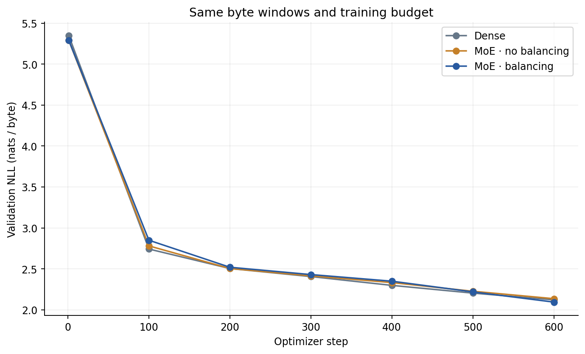
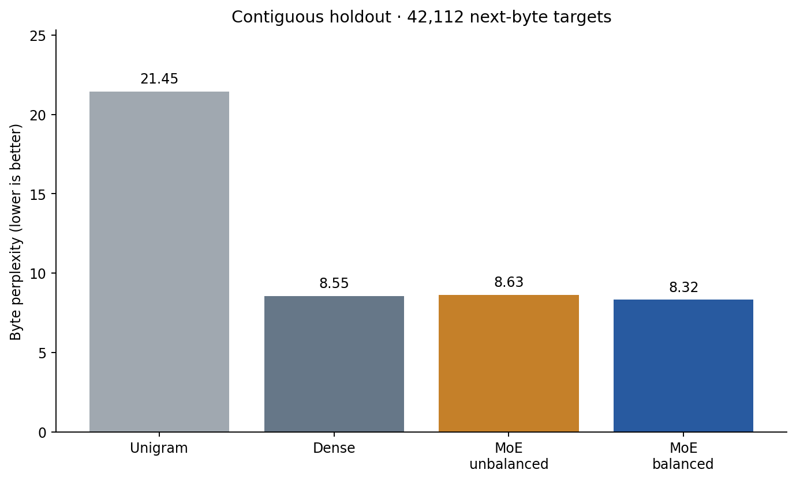
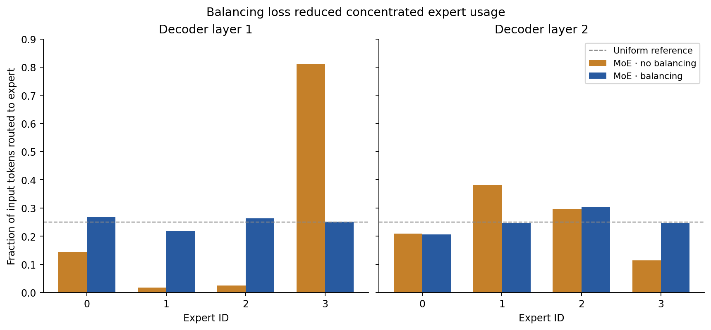
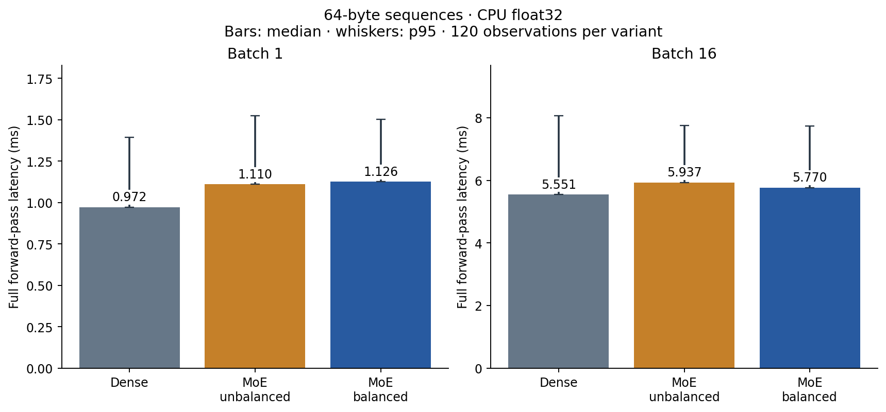
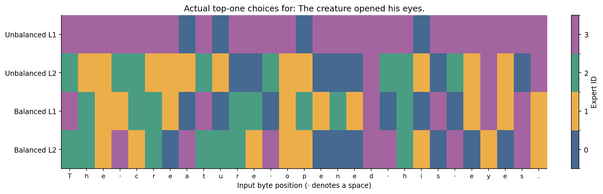
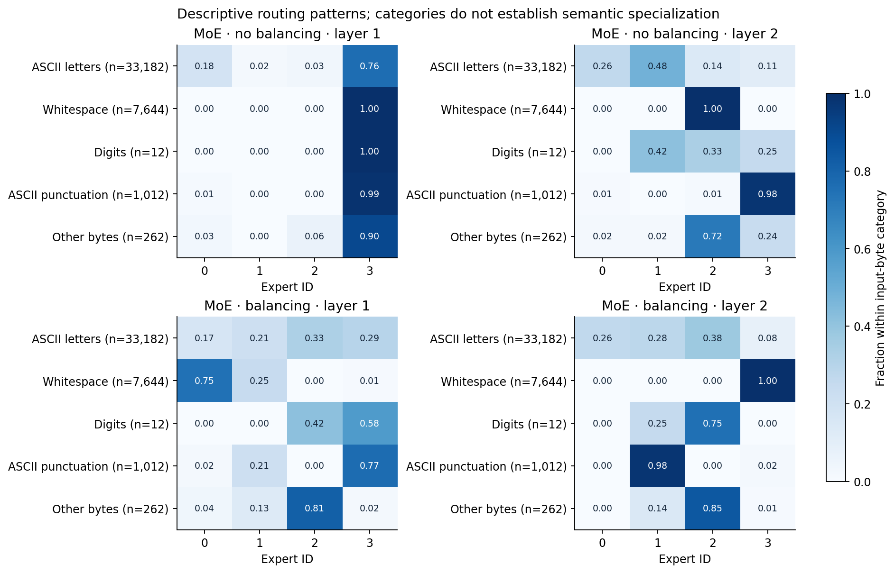

# موازنة الحمل في نموذج الخبراء

مقارنة نموذج كثيف مع توجيه إلى خبير واحد، مرةً دون خسارة موازنة ومرةً معها، لقياس جودة التنبؤ وتوزيع الحمل وزمن الاستدلال.

استخدمت التجربة 421,536 بايتًا من «فرانكنشتاين»، بأربعة خبراء ومفردات من 256 بايتًا. اختيرت نقاط الحفظ على التحقق، وجميعها عند الخطوة 600. بدأ النموذجان المتناثران بالأوزان نفسها وبالنوافذ نفسها وبالترتيب نفسه؛ الاختلاف في معامل الموازنة.

بلغت حيرة الاختبار للنموذج المتوازن 8.3231 مقابل 8.5521 للكثيف. خفضت الموازنة تركّز الحمل في الطبقة الأولى من 81.22% لأكثر خبير استخدامًا إلى 26.74%. لم تُسقط رموز، ولم يكن أي خبير غير مستخدم بالكامل.

عدد المعاملات النشطة تقدير لا يساوي قياس العمليات أو خفض الذاكرة؛ تبقى أوزان جميع الخبراء محفوظة. كانت النماذج المتناثرة أبطأ على المعالج المركزي في هذه التجربة.

استُخدمت البذرة 42 و600 خطوة ودفعة 16، بمجموع 614,400 هدف بايت مأخوذ بالعينة. تتضمن بيانات الاختبار 42,112 هدفًا. لا تمثل نوافذ الكتاب طيات تحقق متقاطع مستقلة، ولا يثبت التشغيل الواحد تفوقًا عامًا.

## النتائج المسجّلة

الأرقام التالية من التنفيذ المحفوظ لهذه النسخة؛ لم تُعَد التجارب أثناء تعريب التوثيق.

### اختيار نقطة الحفظ على التحقق

| النموذج | معامل الموازنة | إجمالي المعاملات | تقدير المعاملات النشطة لكل رمز | NLL للتحقق ↓ |
| :--- | ---: | ---: | ---: | ---: |
| كثيف | 0 | 103,040 | 103,040 | 2.1233 |
| خبراء دون موازنة | 0 | 251,008 | 103,552 | 2.1372 |
| **خبراء مع موازنة** | **0.01** | **251,008** | **103,552** | **2.0955** |

### التقييم النهائي على الاختبار المحفوظ

| النموذج | NLL بوحدة نات لكل بايت ↓ | حيرة البايت ↓ | دقة البايت التالي ↑ |
| :--- | ---: | ---: | ---: |
| **خبراء متوازنون** | **2.1190** | **8.3231** | **37.24%** |
| كثيف | 2.1462 | 8.5521 | 36.71% |
| خبراء غير متوازنين | 2.1548 | 8.6266 | 35.90% |
| خط أساس أحادي الرموز | 3.0657 | 21.4486 | — |

### حمل الخبراء

| النموذج | حصة أكثر الخبراء استخدامًا في الطبقة 1 | حصة أكثر الخبراء استخدامًا في الطبقة 2 | أقصى حمل ÷ المتوسط في الطبقة 1 | الخبراء غير المستخدمين |
| :--- | ---: | ---: | ---: | ---: |
| خبراء غير متوازنين | 81.22% | 38.16% | 3.249× | 0 |
| خبراء متوازنون | **26.74%** | **30.20%** | **1.070×** | 0 |

### الاستدلال على المعالج المركزي

| حجم الدفعة | النموذج | الوسيط بالمللي ثانية ↓ | المئين 95 بالمللي ثانية ↓ | نسبة السرعة إلى النموذج الكثيف ↑ |
| ---: | :--- | ---: | ---: | ---: |
| 1 | كثيف | **0.972** | 1.395 | 1.000× |
| 1 | خبراء غير متوازنين | 1.110 | 1.524 | 0.876× |
| 1 | خبراء متوازنون | 1.126 | 1.502 | 0.864× |
| 16 | كثيف | **5.551** | 8.066 | 1.000× |
| 16 | خبراء غير متوازنين | 5.937 | 7.759 | 0.935× |
| 16 | خبراء متوازنون | 5.770 | 7.745 | 0.962× |

## الرسوم والنتائج المرئية

الرسوم محفوظة من التنفيذ الأصلي. تعريب هذه الصفحة لا يغيّر بياناتها أو تسميات الصور داخل الملفات.

## الملفات المرجعية

- [درجات التنفيذ المحفوظة](runs/metrics.json).
- [بيانات التدقيق وبيئة التنفيذ](audit.json).
- [مرجع البيانات وبصماتها وحدود التقسيم](data/manifest.json).
- [تفاصيل استخدام الأداة](USAGE.md).

## المصادر والإسناد

- [مصدر 1: Fedus, Zoph and Shazeer, *Switch Transformers*](https://jmlr.org/papers/v23/21-0998.html).
- [مصدر 2: Mary Wollstonecraft Shelley, *Frankenstein*, Project Gutenberg ebook 84](https://www.gutenberg.org/ebooks/84).

[المرجع التقني الإنجليزي الكامل](README.en.md) يحفظ تفاصيل النسخة الأصلية. تُترك أسماء الملفات والأوامر ومعرّفات النماذج والمقاييس بصيغتها التقنية لضمان تطابقها مع الكود.
